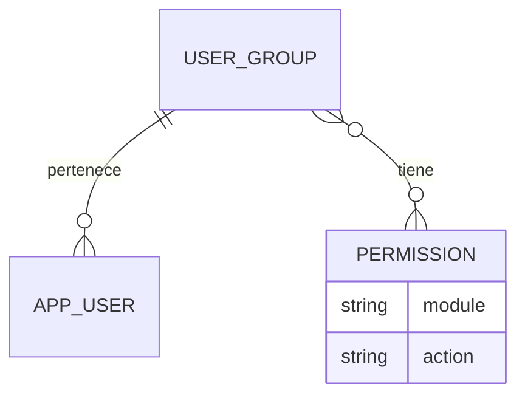

# La Licorería: API, sesión y permisos

El monolito usa Symfony 7.4 para la API y JavaScript con `fetch` para el frontend.
Twig sirve la estructura HTML; el navegador consulta los datos y los permisos
por JSON. Abrir **http://localhost/login**. Administrador inicial: **admin / admin**.

## Modelo de autorización



Un `ROLE_USER` pertenece como máximo a un grupo. Sus permisos provienen
exclusivamente de ese grupo. Los permisos no se asignan directamente a usuarios,
no son roles de Symfony y no se guardan como autoridad en la sesión.

`ROLE_ADMIN` tiene acceso completo a los módulos y acciones registrados, incluso
sin grupo. Su acceso no depende de las asignaciones ni de los permisos del grupo.
La API no permite asignarle un grupo.

Reglas:

1. Sin sesión: la API devuelve 401.
2. Administrador: acceso completo, sin consultar permisos de grupo.
3. Usuario sin grupo, o grupo sin permiso de ver: módulo denegado con 403.
4. Para consultar un módulo se requiere `<module>.view`.
5. Para escribir se requieren `view` y el permiso específico `create`, `update`
   o `delete`. Ninguna acción implica otra.
6. Las asignaciones de permisos a grupos y de usuarios a grupos son exclusivas
   del administrador. Un usuario normal no puede elevar sus propios accesos.
7. Cada petición consulta las asignaciones actuales en MySQL: revocar permisos
   o cambiar de grupo tiene efecto en la siguiente petición, sin otro login.

El catálogo contiene 24 permisos: seis módulos por cuatro acciones.

| Módulo | Clave | Acciones |
| --- | --- | --- |
| Productos | `products` | `view`, `create`, `update`, `delete` |
| Ventas | `sales` | `view`, `create`, `update`, `delete` |
| Inventario | `inventory` | `view`, `create`, `update`, `delete` |
| Grupos | `groups` | `view`, `create`, `update`, `delete` |
| Usuarios | `users` | `view`, `create`, `update`, `delete` |
| Permisos | `permissions` | `view`, `create`, `update`, `delete` |

Las claves completas tienen el formato `products.view`, `products.create`, etc.
El catálogo es fijo y se instala mediante migraciones; no se pueden inventar
permisos ni enviar `ROLE_ADMIN` como permiso. Algunos permisos quedan reservados
para acciones de módulos que aún no están implementados.

Ejemplo: un grupo con `products.view` y `products.create` puede consultar y crear
productos, pero no actualizarlos ni eliminarlos. No puede entrar a otros módulos.

## Organización del código

- `src/Entity/UserGroup.php`: grupo y relación con permisos.
- `src/Entity/Permission.php`: catálogo, único por módulo y acción.
- `src/Entity/User.php`: relación opcional con un grupo. Sin grupo, acceso denegado.
- `src/Authorization/Module.php` y `Action.php`: claves admitidas.
- `src/Authorization/PermissionChecker.php`: única política de autorización.
- `src/Authorization/GroupPermissionEditor.php`: valida asignaciones y la
  dependencia del permiso de ver.
- `src/EventListener/ModulePermissionListener.php`: aplica permisos antes de
  ejecutar controladores. Las nuevas API sin módulo se deniegan por defecto;
  únicamente se exceptúan las rutas de sesión y la ruta administrativa general.
- `src/Authorization/UserAccessView.php`: contrato común del login y `/api/me`.

Symfony gestiona autenticación, sesión y los roles generales. Los permisos de
negocio se resuelven en esta capa propia, sin voters ni roles por módulo.

Para agregar un módulo:

1. Registrarlo en `Module` y crear una migración con sus cuatro permisos.
2. Declarar `_permission_module` en las rutas de su API.
3. Añadir su entrada de navegación usando la misma clave.
4. Probar sus accesos permitidos y denegados.

Ejemplo de declaración de rutas:

```php
#[Route('/api/products', defaults: [
    '_format' => 'json',
    '_permission_module' => 'products',
])]
```

GET/HEAD requieren `view`; POST, `create`; PUT/PATCH, `update`; DELETE, `delete`.
Para operaciones que no sigan esa convención, declarar también
`_permission_action` con una acción conocida. Las claves desconocidas se deniegan.

## Sesión y CSRF

La sesión usa una cookie HttpOnly de Symfony y las solicitudes incluyen
`credentials: 'same-origin'`. No se guardan credenciales en localStorage.

| Método | Ruta | Resultado |
| --- | --- | --- |
| GET | `/api/csrf` | Tokens `login`, `logout`, `products`, `groups`, `permissions`, `users` |
| POST | `/api/login` | Autentica con JSON y devuelve `user` |
| GET | `/api/me` | Usuario, grupo y matriz efectiva de permisos |
| POST | `/api/logout` | Invalida la sesión |
| GET | `/api/admin` | Acceso general exclusivo de `ROLE_ADMIN` |
| GET | `/api/modules/{module}/access` | Comprueba `view` y devuelve las acciones del módulo |

Login:

```json
{"username":"admin","password":"admin","_csrf_token":"token login de /api/csrf"}
```

Logout recibe `_csrf_token` como `application/x-www-form-urlencoded`, usando el
token `logout`. Las respuestas son JSON; los errores usan `{"error":"mensaje"}`.

`user` contiene `id`, `username`, `roles`, `group` y `permissions`. La matriz
`permissions` tiene una entrada por módulo, con cuatro booleanos. Un administrador
recibe todos en `true`; un usuario sin acceso, todos en `false`.

La navegación muestra únicamente módulos con `view`. Abrir una URL directamente
también comprueba el acceso por API. La seguridad se aplica en el backend, aunque
se modifique el JavaScript del navegador.

## Configuración de grupos mediante API

Las escrituras requieren `X-CSRF-Token` con el token indicado y la cookie de sesión.

| Método | Ruta | Permiso / token CSRF |
| --- | --- | --- |
| GET | `/api/groups` | `groups.view` |
| GET | `/api/groups/{id}` | `groups.view` |
| POST | `/api/groups` | `groups.create` / `groups` |
| PUT o PATCH | `/api/groups/{id}` | `groups.update` / `groups` |
| DELETE | `/api/groups/{id}` | `groups.delete` / `groups` |
| GET | `/api/permissions` | `permissions.view` |
| PUT | `/api/groups/{id}/permissions` | Solo administrador / `permissions` |
| GET | `/api/users` | `users.view` |
| PUT | `/api/users/{id}/group` | Solo administrador / `users` |

El administrador supera todos los permisos anteriores. Las listas de usuarios y
grupos aceptan `page` y `limit` (20 por defecto, máximo 100), y devuelven
`data` más `pagination` con `page`, `limit`, `total`.

Flujo del administrador:

1. Crear un grupo con `POST /api/groups`: `{"name":"Cajeros"}`.
2. Consultar `GET /api/permissions` para obtener las claves disponibles.
3. Reemplazar los permisos del grupo con `PUT /api/groups/{id}/permissions`:

   ```json
   {"permissions":["products.view","products.create"]}
   ```

4. Consultar `GET /api/users` y asignar el grupo con `PUT /api/users/{id}/group`:

   ```json
   {"group_id":12}
   ```

La lista de permisos se reemplaza por completo. Una lista vacía revoca todos los
accesos. `{"group_id":null}` retira el grupo y deja al usuario sin acceso a
módulos; aún puede consultar su sesión y cerrarla. No se elimina un grupo con
usuarios asignados (409). Nombres de grupo duplicados devuelven 409 y los datos
inválidos, 422. No se aceptan roles ni permisos adicionales en estos payloads.

Las interfaces para administrar estas asignaciones quedan pendientes; el flujo
ya está disponible y protegido por API.

## Productos

La tabla `product` contiene nombre, código de barras único, precio de venta y
precio de costo. Los precios usan `DECIMAL(12,2)` y se devuelven como cadenas.

| Método | Ruta | Permiso / token CSRF |
| --- | --- | --- |
| GET | `/api/products?page=1&limit=20` | `products.view` |
| GET | `/api/products/{id}` | `products.view` |
| POST | `/api/products` | `products.create` / `products` |
| PUT o PATCH | `/api/products/{id}` | `products.update` / `products` |
| DELETE | `/api/products/{id}` | `products.delete` / `products` |

Crear o reemplazar completamente:

```json
{
  "name":"Ron 750 ml",
  "barcode":"0007701234567",
  "sale_price":"45000.00",
  "cost_price":"32000.00"
}
```

Nombre: 1–180 caracteres. Código: texto de 1–100 caracteres, conservando ceros
iniciales. Precios: de 0 a 9999999999.99; usar cadenas para decimales (sin float).
PATCH actualiza solo los campos enviados. Datos inválidos: 422; código duplicado:
409; inexistente: 404. Crear devuelve 201; consultar o editar, 200; eliminar, 204.

## Pantalla de productos

`/productos` muestra un listado paginado de 20 productos, con nombre, código de
barras y ambos precios. `public/scripts/products.js` consume la API existente;
`public/scripts/api.js` comparte el cliente HTTP con la autenticación.

- `view`: permite abrir el catálogo y consultar el listado.
- `create`: muestra **Nuevo producto** y permite guardar el alta.
- `update`: muestra **Editar** y permite guardar cambios.
- `delete`: muestra **Eliminar** y exige confirmar la operación.

Antes de abrir un formulario o escribir se consultan nuevamente los permisos.
Si se revoca una acción, se ocultan sus controles; si se revoca `view`, se vacía
el listado y se muestra acceso restringido. El backend conserva la comprobación
autoritativa en cada solicitud, incluida la protección CSRF.

Los precios admiten punto o coma decimal sin separadores de miles en el
formulario y se envían como cadenas exactas. Los errores por campo, los códigos
duplicados y los fallos de conexión se muestran sin perder los datos del formulario.
La eliminación usa un diálogo con confirmación; cancelar no realiza escrituras.

## Inicialización y pruebas

Desde la raíz del repositorio, con los servicios levantados:

```bash
docker compose --env-file app/.env.local exec php composer install
docker compose --env-file app/.env.local exec php php bin/console doctrine:migrations:migrate --no-interaction
docker compose --env-file app/.env.local exec php php bin/console app:create-admin
python3 app/tests/permissions_smoke.py
```

Las migraciones ya se aplicaron al entorno local. No se conceden permisos a los
usuarios existentes de forma automática. `app:create-admin` conserva sin cambios
una cuenta `admin` existente.

Las 26 pruebas HTTP cubren autenticación, productos, permisos por acción,
aislamiento entre módulos/grupos, revocación sin nuevo login, administración y
protección contra elevación de permisos. Crean datos temporales y los eliminan
al terminar. Requieren el Compose local y la API en `http://localhost`.


Pruebas de navegador para Productos (Chromium aislado en Docker):

```bash
python3 app/tests/run_products_browser.py
```

Cubren creación, edición, eliminación con confirmación, código duplicado,
paginación, permisos por acción, revocación con un formulario abierto,
caducidad de sesión, fallos de conexión y vista móvil. El ejecutor crea un
usuario/grupo temporales y los elimina al terminar; no cambia dependencias de
la aplicación. La primera ejecución descarga el entorno de navegador.
