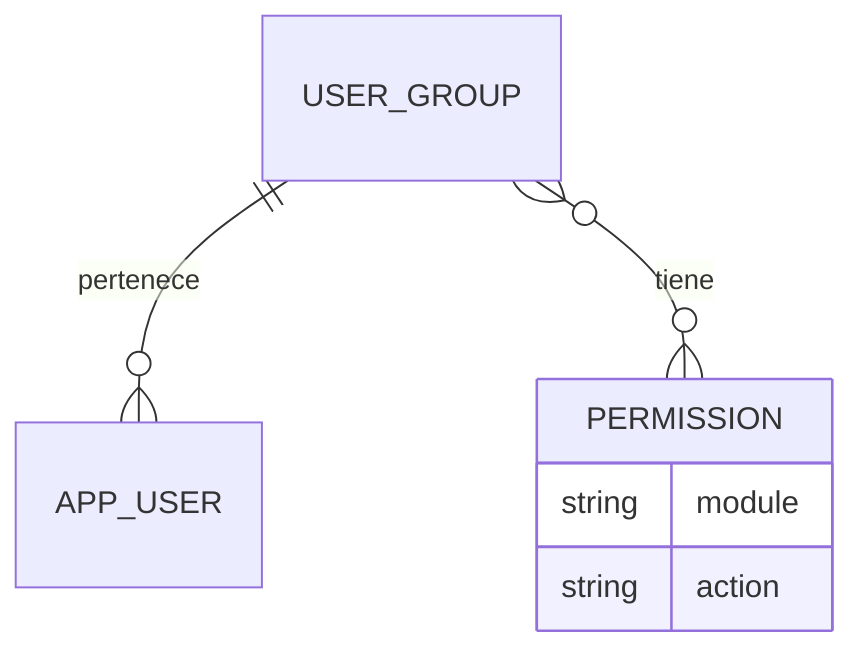

# La Licorería: API, sesión y permisos

El monolito usa Symfony 7.4 para la API y JavaScript con `fetch` para el frontend.
Twig sirve la estructura HTML; el navegador consulta los datos y los permisos
por JSON. Abrir **http://localhost/login**. Administrador inicial: **admin / admin**.

## Modelo de autorización



Un `ROLE_USER` pertenece como máximo a un grupo. Sus permisos provienen
exclusivamente de ese grupo. Los permisos no se asignan directamente a usuarios,
no son roles de Symfony y no se guardan como autoridad en la sesión.

`ROLE_ADMIN` tiene acceso completo a los módulos y acciones registrados, incluso
sin grupo. Su acceso no depende de las asignaciones ni de los permisos del grupo.
La API no permite asignarle un grupo.

Reglas:

1. Sin sesión: la API devuelve 401.
2. Administrador: acceso completo, sin consultar permisos de grupo.
3. Usuario sin grupo, o grupo sin permiso de ver: módulo denegado con 403.
4. Para consultar un módulo se requiere `<module>.view`.
5. Para escribir se requieren `view` y el permiso específico `create`, `update`
   o `delete`. Ninguna acción implica otra.
6. Las asignaciones de permisos a grupos y de usuarios a grupos son exclusivas
   del administrador. Un usuario normal no puede elevar sus propios accesos.
7. Cada petición consulta las asignaciones actuales en MySQL: revocar permisos
   o cambiar de grupo tiene efecto en la siguiente petición, sin otro login.

El catálogo contiene 32 permisos: ocho módulos por cuatro acciones.

| Módulo | Clave | Acciones |
| --- | --- | --- |
| Productos | `products` | `view`, `create`, `update`, `delete` |
| Ventas | `sales` | `view`, `create`, `update`, `delete` |
| Empresa | `company` | `view`, `create`, `update`, `delete` |
| Facturación | `billing` | `view`, `create`, `update`, `delete` |
| Inventario | `inventory` | `view`, `create`, `update`, `delete` |
| Grupos | `groups` | `view`, `create`, `update`, `delete` |
| Usuarios | `users` | `view`, `create`, `update`, `delete` |
| Permisos | `permissions` | `view`, `create`, `update`, `delete` |

Las claves completas tienen el formato `products.view`, `products.create`, etc.
El catálogo se declara en código y se registra mediante migraciones o el comando
`app:permissions:sync`; no se pueden inventar
permisos ni enviar `ROLE_ADMIN` como permiso. Algunos permisos quedan reservados
para acciones de módulos que aún no están implementados.

Ejemplo: un grupo con `products.view` y `products.create` puede consultar y crear
productos, pero no actualizarlos ni eliminarlos. No puede entrar a otros módulos.

## Organización del código

- `src/Entity/UserGroup.php`: grupo y relación con permisos.
- `src/Entity/Permission.php`: catálogo, único por módulo y acción.
- `src/Entity/User.php`: relación opcional con un grupo. Sin grupo, acceso denegado.
- `src/Authorization/Module.php` y `Action.php`: claves admitidas.
- `src/Authorization/PermissionChecker.php`: única política de autorización.
- `src/Authorization/GroupPermissionEditor.php`: valida asignaciones y la
  dependencia del permiso de ver.
- `src/EventListener/ModulePermissionListener.php`: aplica permisos antes de
  ejecutar controladores. Las nuevas API sin módulo se deniegan por defecto;
  únicamente se exceptúan las rutas de sesión y la ruta administrativa general.
- `src/Authorization/UserAccessView.php`: contrato común del login y `/api/me`.

Symfony gestiona autenticación, sesión y los roles generales. Los permisos de
negocio se resuelven en esta capa propia, sin voters ni roles por módulo.

Para agregar un módulo:

1. Registrarlo en `Module` y ejecutar `php bin/console app:permissions:sync`
   durante el despliegue. El comando crea las cuatro acciones faltantes sin
   duplicar registros ni conceder permisos a grupos.
2. Declarar `_permission_module` en las rutas de su API.
3. Añadir su entrada de navegación usando la misma clave.
4. Probar sus accesos permitidos y denegados.

Ejemplo de declaración de rutas:

```php
#[Route('/api/products', defaults: [
    '_format' => 'json',
    '_permission_module' => 'products',
])]
```

GET/HEAD requieren `view`; POST, `create`; PUT/PATCH, `update`; DELETE, `delete`.
Para operaciones que no sigan esa convención, declarar también
`_permission_action` con una acción conocida. Las claves desconocidas se deniegan.

## Sesión y CSRF

La sesión usa una cookie HttpOnly de Symfony y las solicitudes incluyen
`credentials: 'same-origin'`. No se guardan credenciales en localStorage.

| Método | Ruta | Resultado |
| --- | --- | --- |
| GET | `/api/csrf` | Tokens `login`, `logout`, `products`, `sales`, `groups`, `permissions`, `users`, `company` |
| POST | `/api/login` | Autentica con JSON y devuelve `user` |
| GET | `/api/me` | Usuario, grupo y matriz efectiva de permisos |
| POST | `/api/logout` | Invalida la sesión |
| GET | `/api/admin` | Acceso general exclusivo de `ROLE_ADMIN` |
| GET | `/api/modules/{module}/access` | Comprueba `view` y devuelve las acciones del módulo |

Login:

```json
{"username":"admin","password":"admin","_csrf_token":"token login de /api/csrf"}
```

Logout recibe `_csrf_token` como `application/x-www-form-urlencoded`, usando el
token `logout`. Las respuestas son JSON; los errores usan `{"error":"mensaje"}`.

`user` contiene `id`, `username`, `roles`, `group` y `permissions`. La matriz
`permissions` tiene una entrada por módulo, con cuatro booleanos. Un administrador
recibe todos en `true`; un usuario sin acceso, todos en `false`.

La navegación muestra únicamente módulos con `view`. Abrir una URL directamente
también comprueba el acceso por API. La seguridad se aplica en el backend, aunque
se modifique el JavaScript del navegador.

## Configuración de grupos mediante API

Las escrituras requieren `X-CSRF-Token` con el token indicado y la cookie de sesión.

| Método | Ruta | Permiso / token CSRF |
| --- | --- | --- |
| GET | `/api/groups` | `groups.view` |
| GET | `/api/groups/{id}` | `groups.view` |
| POST | `/api/groups` | `groups.create` / `groups` |
| PUT o PATCH | `/api/groups/{id}` | `groups.update` / `groups` |
| DELETE | `/api/groups/{id}` | `groups.delete` / `groups` |
| GET | `/api/permissions` | `permissions.view` |
| PUT | `/api/groups/{id}/permissions` | Solo administrador / `permissions` |
| GET | `/api/users` | `users.view` |
| PUT | `/api/users/{id}/group` | Solo administrador / `users` |

El administrador supera todos los permisos anteriores. Las listas de usuarios y
grupos aceptan `page` y `limit` (20 por defecto, máximo 100), y devuelven
`data` más `pagination` con `page`, `limit`, `total`.

Flujo del administrador:

1. Crear un grupo con `POST /api/groups`: `{"name":"Cajeros"}`.
2. Consultar `GET /api/permissions` para obtener las claves disponibles.
3. Reemplazar los permisos del grupo con `PUT /api/groups/{id}/permissions`:

   ```json
   {"permissions":["products.view","products.create"]}
   ```

4. Consultar `GET /api/users` y asignar el grupo con `PUT /api/users/{id}/group`:

   ```json
   {"group_id":12}
   ```

La lista de permisos se reemplaza por completo. Una lista vacía revoca todos los
accesos. `{"group_id":null}` retira el grupo y deja al usuario sin acceso a
módulos; aún puede consultar su sesión y cerrarla. No se elimina un grupo con
usuarios asignados (409). Nombres de grupo duplicados devuelven 409 y los datos
inválidos, 422. No se aceptan roles ni permisos adicionales en estos payloads.

Las interfaces para administrar estas asignaciones quedan pendientes; el flujo
ya está disponible y protegido por API.

## Productos

La tabla `product` contiene nombre, código de barras único, precio de venta y
precio de costo. Los precios usan `DECIMAL(12,2)` y se devuelven como cadenas.

| Método | Ruta | Permiso / token CSRF |
| --- | --- | --- |
| GET | `/api/products?page=1&limit=20` | `products.view` |
| GET | `/api/products/{id}` | `products.view` |
| POST | `/api/products` | `products.create` / `products` |
| PUT o PATCH | `/api/products/{id}` | `products.update` / `products` |
| DELETE | `/api/products/{id}` | `products.delete` / `products` |

Crear o reemplazar completamente:

```json
{
  "name":"Ron 750 ml",
  "barcode":"0007701234567",
  "sale_price":"45000.00",
  "cost_price":"32000.00"
}
```

Nombre: 1–180 caracteres. Código: texto de 1–100 caracteres, conservando ceros
iniciales. Precios: de 0 a 9999999999.99; usar cadenas para decimales (sin float).
PATCH actualiza solo los campos enviados. Datos inválidos: 422; código duplicado:
409; inexistente: 404. Crear devuelve 201; consultar o editar, 200; eliminar, 204.

## Pantalla de productos

`/productos` muestra un listado paginado de 20 productos, con nombre, código de
barras y ambos precios. `public/scripts/products.js` consume la API existente;
`public/scripts/api.js` comparte el cliente HTTP con la autenticación.

El filtro por código de barras busca una coincidencia exacta en todo el catálogo.
Permite escribir o escanear el código y pulsar Enter o **Buscar**. **Limpiar filtro**
restaura el listado. La API admite `GET /api/products?barcode=0007701234567`;
el total y la paginación corresponden a los resultados filtrados. Un código vacío
omite el filtro y los ceros iniciales se conservan.

Cada producto admite una imagen opcional JPG, PNG o WebP de hasta 2 MB y 20
megapíxeles. El formulario muestra una vista previa y el catálogo una miniatura.
Las imágenes se guardan en MinIO bajo `products/` con nombres aleatorios; MySQL
solo almacena la clave del objeto. El bucket `MINIO_BUCKET` se crea en la primera
carga si todavía no existe. Se usan `MINIO_ENDPOINT`, `MINIO_REGION`,
`MINIO_ROOT_USER` y `MINIO_ROOT_PASSWORD` desde `.env.local`.

Las solicitudes JSON existentes siguen funcionando. Para enviar una imagen,
usa `multipart/form-data` con `data` (JSON con los campos habituales) e `image`
(archivo): `POST /api/products` para crear, `POST /api/products/{id}` para editar
(requiere `products.update`). La respuesta incluye `image_url`, o `null` cuando
no hay imagen. `GET /api/products/{id}/image` requiere `products.view` y entrega
la imagen desde el bucket privado. Editar sin archivo conserva la imagen;
reemplazarla o eliminar el producto borra el objeto anterior de MinIO. Si falla
esa limpieza, el servidor registra la clave para su eliminación posterior.

- `view`: permite abrir el catálogo y consultar el listado.
- `create`: muestra **Nuevo producto** y permite guardar el alta.
- `update`: muestra **Editar** y permite guardar cambios.
- `delete`: muestra **Eliminar** y exige confirmar la operación.

Antes de abrir un formulario o escribir se consultan nuevamente los permisos.
Si se revoca una acción, se ocultan sus controles; si se revoca `view`, se vacía
el listado y se muestra acceso restringido. El backend conserva la comprobación
autoritativa en cada solicitud, incluida la protección CSRF.

Los precios admiten punto o coma decimal sin separadores de miles en el
formulario y se envían como cadenas exactas. Los errores por campo, los códigos
duplicados y los fallos de conexión se muestran sin perder los datos del formulario.
La eliminación usa un diálogo con confirmación; cancelar no realiza escrituras.

## Inicialización y pruebas

Desde la raíz del repositorio, con los servicios levantados:

```bash
docker compose --env-file app/.env.local exec php composer install
docker compose --env-file app/.env.local exec php php bin/console doctrine:migrations:migrate --no-interaction
docker compose --env-file app/.env.local exec php php bin/console app:create-admin
python3 app/tests/permissions_smoke.py
```

Las migraciones ya se aplicaron al entorno local. No se conceden permisos a los
usuarios existentes de forma automática. `app:create-admin` conserva sin cambios
una cuenta `admin` existente.

Las 26 pruebas HTTP cubren autenticación, productos, permisos por acción,
aislamiento entre módulos/grupos, revocación sin nuevo login, administración y
protección contra elevación de permisos. Crean datos temporales y los eliminan
al terminar. Requieren el Compose local y la API en `http://localhost`.


Pruebas de navegador para Productos (Chromium aislado en Docker):

```bash
python3 app/tests/run_products_browser.py
```

Cubren creación, edición, eliminación con confirmación, código duplicado,
paginación, permisos por acción, revocación con un formulario abierto,
caducidad de sesión, fallos de conexión y vista móvil. El ejecutor crea un
usuario/grupo temporales y los elimina al terminar; no cambia dependencias de
la aplicación. La primera ejecución descarga el entorno de navegador.


## Empresa

Abrir `/empresa`, en **Administrativos**, para registrar o editar una única ficha
con nombre, dirección, teléfono y NIT. Todos los campos son obligatorios. El NIT
y el teléfono se guardan como texto, conservando ceros, guiones y prefijos.
No se comprueba la validez fiscal del NIT. La pantalla usa el permiso
`company.view`; registrar requiere además `company.create` y editar,
`company.update`. El administrador tiene acceso completo. No se conceden
permisos automáticamente a grupos existentes.

| Método | Ruta | Resultado / permiso |
| --- | --- | --- |
| GET | `/api/company` | `data` con la ficha o `null` si falta / `company.view` |
| POST | `/api/company` | Registrar (201); una segunda ficha devuelve 409 / `company.create` |
| PUT | `/api/company` | Reemplazar los cuatro campos / `company.update` |
| PATCH | `/api/company` | Actualizar solo los campos enviados / `company.update` |

Las escrituras requieren `X-CSRF-Token` con el token `company` de `/api/csrf`.
PUT/PATCH devuelven 404 si todavía no existe la ficha. No hay endpoint de borrado;
`company.delete` queda reservado. Los campos desconocidos, vacíos, de tipo
incorrecto o con caracteres de control se rechazan con 422 y errores por campo.
Límites: nombre 180 caracteres, dirección 255, teléfono y NIT 40 cada uno.

Ejemplo de alta:

```json
{"name":"La Licorería","address":"Calle 10 # 20-30","phone":"+57 3001234567","nit":"900123456-7"}
```

La migración `Version20261110070000` crea la ficha única y su catálogo de permisos.
Al facturar se conserva una copia de los datos de Empresa en la factura,
para que posteriores cambios de la ficha no alteren los comprobantes cerrados.

Pruebas: `python3 app/tests/company_smoke.py`. La prueba de escritura utiliza
una ficha temporal y la elimina al terminar; si ya existe una empresa real,
conserva sus datos y omite esa prueba.

Prueba del formulario y revocación de acceso en Chromium:

```bash
BROWSER_TEST_FILE=company_browser.py python3 app/tests/run_products_browser.py
```

## Facturación

`/facturacion` aparece en Operativos con `billing.view`. Lista las ventas guardadas,
con filtro por estado y paginación. El administrador tiene acceso automáticamente.

En Ventas, **Pendiente de pago** guarda el carrito sin cobrarlo y permite preparar
otra venta. Se pueden conservar varios pendientes. **Pagar** confirma el pago y
crea directamente una factura cerrada. Ambas acciones vacían el carrito después
de guardar y requieren `sales.create` y `sales.view`.

En Facturación, los pendientes muestran **Editar** y **Pagar** con `billing.update`.
La edición permite escanear productos, retirar líneas y cambiar cantidades;
se deben guardar los cambios antes de pagar desde el listado. Se conservan los
precios acordados para las líneas existentes y se usa el precio actual para
productos nuevos. Los registros facturados muestran solamente **Imprimir**,
que envía una solicitud a Messenger con `billing.view`. La confirmación de la
cola no confirma la salida física del ticket.

| Método | Ruta | Descripción |
| --- | --- | --- |
| GET | `/api/billing?status=pending&page=1&limit=20` | Listar; `status` es opcional (`pending` o `paid`) |
| GET | `/api/billing/{id}` | Consultar registro |
| GET | `/api/billing/product?barcode=...` | Buscar producto para editar; requiere `billing.update` |
| PATCH | `/api/billing/{id}` | Guardar `revision` e `items` con `product_id` y `quantity` |
| POST | `/api/billing/{id}/pay` | Confirmar pago con `revision` |
| POST | `/api/billing/{id}/print` | Encolar impresión con `print_job_id` de 32 caracteres hexadecimales |

Las escrituras usan el token CSRF `billing` de `/api/csrf`. Edición y pago
comprueban la revisión bajo bloqueo de base de datos para evitar sobrescribir
cambios de otra ventana. Una factura pagada rechaza edición y nuevo cobro con
409; un pendiente rechaza impresión. Antes de cobrar debe existir la ficha Empresa.

Pruebas: `python3 app/tests/billing_smoke.py` y
`python3 app/tests/run_billing_browser.py`. La prueba de navegador simula la
respuesta de la cola de impresión para no generar tickets físicos y elimina
los registros de su usuario temporal al terminar.

## Ventas y lector de código de barras

Abrir `/ventas`. El campo de lectura recibe el foco cuando termina de cargar el
carrito. Un lector que envía Enter funciona como teclado; también se puede
escribir un código manualmente y presionar Enter o **Agregar**.

- Cada lectura agrega una unidad. Repetir el código incrementa la misma línea.
- Un producto distinto agrega otra línea, conservando el orden de lectura.
- El campo se limpia inmediatamente y la cola de solicitudes conserva todas
  las lecturas rápidas, sin enviar escrituras simultáneas desde esta pantalla.
- El precio se toma del catálogo en el servidor; el cliente no envía precios.
- Cantidades y totales se calculan en centavos enteros y se devuelven como
  cadenas decimales exactas. Los precios de costo no se exponen en esta API.
- El carrito persiste al cambiar de ruta o recargar dentro de la sesión, y se
  aísla por usuario. Cerrar sesión lo elimina. No es todavía una venta cobrada.

| Método | Ruta | Permiso |
| --- | --- | --- |
| GET | `/api/sales/cart` | `sales.view` |
| POST | `/api/sales/cart/items` | `sales.create` + `sales.view` |
| PATCH | `/api/sales/cart/items/{product_id}` | `sales.update` + `sales.view` |
| DELETE | `/api/sales/cart/items/{product_id}` | `sales.delete` + `sales.view` |
| DELETE | `/api/sales/cart` | `sales.delete` + `sales.view` |
| POST | `/api/sales/cart/checkout` | `sales.create` + `sales.view` |

Todas las escrituras requieren `X-CSRF-Token` con el valor `sales` de
`/api/csrf`. El administrador supera los permisos de grupo, manteniendo CSRF.

Lectura:

```json
{"barcode":"0007701234567"}
```

Cambio manual de cantidad:

```json
{"quantity":3}
```

Las respuestas incluyen `data.items`, `line_count`, `quantity` y `total`.
Cada línea contiene `product_id`, `name`, `barcode`, `unit_price`, `quantity`
y `subtotal`. Una lectura nueva o repetida requiere `create`; cambiar la cantidad
con controles manuales requiere `update`; retirar o vaciar requiere `delete`.
La cantidad por línea está limitada a 9999, y el carrito a 100 productos distintos.
No se puede reducir una cantidad a cero: para retirar la línea se requiere delete.

Si se elimina un producto del catálogo, la siguiente lectura del carrito lo
retira e informa `removed_unavailable`. Los precios se vuelven a consultar al
leer o modificar el carrito. Para guardar la venta, el checkout recibe `status`
(`pending` o `paid`) y el `checkout_key` de la última lectura. Repetir la misma
referencia devuelve el registro existente sin crear otra factura.

Los permisos de Ventas ya están registrados. El sincronizador también servirá
para los módulos que se agreguen después:

```bash
docker compose --env-file app/.env.local exec php php bin/console app:permissions:sync
```

No modifica asignaciones existentes: los permisos nuevos permanecen sin conceder
hasta que el administrador los asigne a un grupo.

## Alertas y accesos restringidos

Las confirmaciones, errores y avisos usan SweetAlert2 11.26.25, servido localmente
desde `public/vendor/sweetalert2` con su licencia MIT. El cliente compartido es
`public/scripts/alerts.js`. Los avisos de éxito usan toast y los errores de
validación conservan las indicaciones junto al campo.

El acceso restringido usa la ilustración local `public/images/access-denied.svg`.
Las llamadas de JavaScript conservan el error JSON 403; una navegación HTML a
una URL protegida devuelve una página propia con la imagen y estado HTTP 403.
No se muestra la página de excepción de Symfony para esos permisos.

Pruebas de Ventas, Productos, alertas y permisos:

```bash
python3 app/tests/sales_smoke.py
BROWSER_TEST_FILE=sales_browser.py python3 app/tests/run_products_browser.py
```

La suite HTTP contiene 34 casos y la de Chromium 19, incluidas las regresiones
de autenticación, permisos y productos. Las pruebas crean y eliminan sus datos
temporales. El lector se verifica mediante eventos de teclado y lecturas rápidas.
